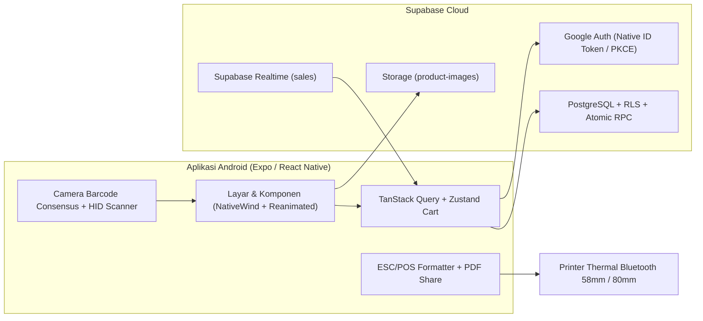

<div align="center">
  
  <h1>src dimas kasir</h1>
  <p>
    Aplikasi kasir Android (POS) ringan dan cepat untuk <strong>Toko SRC Dimas</strong> — dibangun dengan React Native, Expo, TypeScript, dan Supabase.
  </p>

  <p>
    <a href="https://github.com/denaripp/src-dimas-kasir/actions/workflows/ci.yml">
      
    </a>
    <a href="https://github.com/denaripp/src-dimas-kasir/releases/latest">
      
    </a>
    
    
    
    
  </p>

  <p>
    <a href="https://github.com/denaripp/src-dimas-kasir/releases/latest/download/srcdimas-kasir.apk">
      <strong>Download APK Terbaru (srcdimas-kasir.apk)</strong>
    </a>
    &nbsp;&middot;&nbsp;
    <a href="./CHANGELOG.md">Changelog</a>
    &nbsp;&middot;&nbsp;
    <a href="./prd.md">PRD</a>
    &nbsp;&middot;&nbsp;
    <a href="./designsystem.md">Design System</a>
  </p>
</div>

---

## Ringkasan

**src dimas kasir** menggantikan pencatatan manual toko kelontong dengan alur kasir tunai cepat (`< 20 detik` per transaksi), pemindaian barcode kamera maupun scanner eksternal HID, cetak struk thermal Bluetooth ESC/POS (58mm/80mm), ekspor slip PDF ke WhatsApp, serta pencatatan stok dan laba bersih berbasis snapshot modal per transaksi.

## Fitur Utama

| Modul | Kemampuan |
| :--- | :--- |
| **Kasir Tunai** | Katalog 2 kolom berfoto, floating checkout bar, hitung kembalian instan, nominal cepat, dan pemblokiran transaksi otomatis saat offline. |
| **Scanner Barcode & QR** | Pemindai kamera HP (`expo-camera`) dengan **filter konsensus multi-frame** (3 frame identik untuk barcode 1D, 2 frame untuk QR, global cooldown `1200ms`, tombol senter) serta dukungan scanner eksternal HID Bluetooth/USB OTG. |
| **Struk Thermal & PDF** | Cetak langsung ke printer thermal Bluetooth 58mm (32 kolom) & 80mm (48 kolom) dengan nomor struk `SDK-YYYYMMDD-XXXX`, waktu WIB deterministik (`UTC+7`), dan fallback bagikan PDF ke WhatsApp. |
| **Manajemen Barang & Stok** | CRUD barang + upload foto terkompresi (`512px` JPEG), soft-delete jika pernah terjual, mutasi stok atomik (`stok_masuk`, `stok_keluar`, `penyesuaian`), dan peringatan stok menipis. |
| **Impor & Ekspor CSV** | Template standar 7 kolom (`nama,barcode,kategori,harga_jual,harga_modal,stok,stok_minimum`), pratinjau error per baris sebelum simpan, batas 1.000 baris/file, dan proteksi CSV formula injection. |
| **Riwayat Realtime & Void** | Sinkronisasi lintas perangkat via Supabase Realtime, cetak ulang struk, dan pembatalan transaksi (`VOID`) atomik yang mengembalikan stok secara otomatis. |
| **Laporan & Keuangan** | Ringkasan penjualan, laba kotor (berbasis snapshot harga modal saat transaksi), pengeluaran per kategori, laba bersih, grafik penjualan harian, Top 5 barang terlaris, dan ekspor laporan CSV. |
| **Keamanan** | Native Google Sign-In + PKCE, penyimpanan sesi terenkripsi di Android Keystore (`expo-secure-store`), isolasi multi-tenant PostgreSQL RLS ketat, sanitasi perintah kontrol ESC/POS, serta ProGuard/R8 release hardening. |

## Arsitektur Sistem



## Tech Stack

- **Mobile Framework:** React Native `0.79.2`, Expo `SDK 53`, Expo Router `v5`, TypeScript `5.8`
- **Styling & Animasi:** NativeWind `v4` (Tailwind CSS), React Native Reanimated `v3`, FontAwesome 6, Plus Jakarta Sans
- **State & Data:** TanStack React Query `v5`, Zustand `v5`, React Hook Form + Zod
- **Backend & Database:** Supabase (PostgreSQL, Atomic RPC PL/pgSQL, Row Level Security, Realtime, Storage, Edge Functions)
- **Hardware & Media:** `expo-camera`, `react-native-thermal-receipt-printer-image-qr`, `expo-print`, `expo-sharing`, `expo-image`, `expo-image-manipulator`, `papaparse`
- **Testing & Tooling:** Bun Test (`50` unit tests), ESLint (`expo lint`), EAS Build (Android Preview/Release APK)

## Struktur Proyek

```text
src-dimas-kasir/
├── app.config.ts              # Konfigurasi Expo, Android permissions & ProGuard rules
├── eas.json                   # Profil EAS Build (development, preview APK, production)
├── plugins/                   # Expo Config Plugin untuk Android security hardening
├── assets/                    # Icon Android, adaptive icon, dan logo toko
├── supabase/
│   ├── migrations/            # Skema SQL, RLS multi-tenant, dan 9 fungsi RPC atomik
│   ├── functions/             # Edge Function (delete-account)
│   └── tests/                 # Skrip verifikasi SQL keamanan & RPC
└── src/
    ├── app/                   # File-based routing (Beranda, Barang, Kasir, Riwayat, Laporan)
    ├── components/            # Komponen UI modular (scanner, printer, kasir, laporan, modal)
    ├── hooks/                 # React Query hooks (auth, products, sales, reports, printer)
    ├── lib/                   # Utilitas teruji (barcode, format WIB, receipt, CSV, cartCalc)
    │   └── __tests__/         # 9 suite unit test (50 test)
    ├── store/                 # Zustand store (keranjang, printer terpilih, store aktif)
    └── types/                 # Definisi tipe TypeScript database & domain
```

## Menjalankan Secara Lokal

### Prasyarat
- [Bun](https://bun.sh) `>= 1.1` atau Node.js `>= 20`
- Proyek [Supabase](https://supabase.com) yang telah menjalankan seluruh migrasi di `supabase/migrations/`
- Google OAuth Web Client ID & Android Client ID (SHA-1 keystore)

### Instalasi & Variabel Lingkungan

```bash
# 1. Clone repositori
git clone https://github.com/denaripp/src-dimas-kasir.git
cd src-dimas-kasir

# 2. Pasang dependensi
bun install

# 3. Salin file konfigurasi lingkungan dan isi kredensial Supabase + Google
cp .env.example .env.local
```

Isi `.env.local`:
```env
EXPO_PUBLIC_SUPABASE_URL=https://<project-ref>.supabase.co
EXPO_PUBLIC_SUPABASE_KEY=<supabase-publishable-key>
EXPO_PUBLIC_GOOGLE_WEB_CLIENT_ID=<google-web-client-id>.apps.googleusercontent.com
```

### Perintah Pengembangan & Verifikasi

```bash
# Jalankan seluruh unit test
bun test

# Cek tipe TypeScript
bun run typecheck

# Cek linter
bun run lint

# Jalankan di Android (membutuhkan Expo Development Build untuk modul Bluetooth & Google Sign-In)
bun run android

# Build APK Android (profil preview) via EAS Cloud
npx eas-cli build -p android --profile preview
```

## Format Template Impor CSV Barang

Gunakan header persis berikut (`UTF-8`, maks `1.000` baris / `2 MB` per file):

```csv
nama,barcode,kategori,harga_jual,harga_modal,stok,stok_minimum
Indomie Goreng Original,8998866200578,Makanan,3500,2800,20,5
```

- **Wajib:** `nama`, `harga_jual` (bilangan bulat `>= 0` tanpa `Rp`/titik/koma).
- **Opsional:** `barcode`, `kategori`, `harga_modal`, `stok`, `stok_minimum` (kosong otomatis `0`).
- Barang dengan `barcode` yang sudah terdaftar akan diperbarui otomatis (*upsert*).

## Lisensi

Repositori ini dikembangkan untuk kebutuhan operasional internal **Toko SRC Dimas**.
