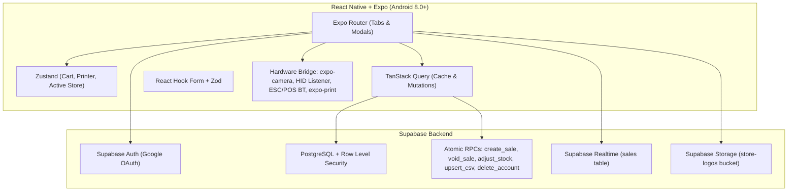

# Implementation Plan: src dimas kasir v0.1.0

Rencana implementasi teknis lengkap untuk membangun aplikasi kasir Android **src dimas kasir v0.1.0** menggunakan **React Native + Expo (Development Build)**, **TypeScript**, **NativeWind (Tailwind CSS)**, dan **Supabase (PostgreSQL, Auth Google, Realtime, Storage)** dengan mengacu penuh pada `prd.md`.

---

## Goal Description

Membangun aplikasi Point of Sale (POS) mobile untuk toko kelontong/retail kecil yang menggantikan pencatatan manual dengan:
- Autentikasi Google (1 akun Google = 1 toko, isolasi penuh via RLS).
- Kasir cepat tunai dengan pemindaian barcode ganda (kamera HP via `expo-camera` + scanner eksternal HID Bluetooth/USB OTG).
- Penyimpanan transaksi, pengurangan stok, dan pencatatan mutasi stok secara **atomik** via PostgreSQL RPC (anti stok minus).
- Cetak struk ke printer thermal Bluetooth ESC/POS (58mm/80mm) dengan format `SDK-YYYYMMDD-XXXX` dan `Rp15.000`, serta fallback bagikan PDF.
- Manajemen barang CRUD (soft delete jika pernah terjual), Import/Export CSV dengan preview error, manajemen stok dengan riwayat mutasi, pencatatan keuangan (laba berbasis snapshot modal saat transaksi + kategori pengeluaran kustom), laporan usaha (Top 5 unit terjual + ekspor CSV), dan history realtime dengan fitur void.

---

## User Review Required

> [!IMPORTANT]
> **Keputusan Teknis & Prasyarat Sebelum Eksekusi:**
> 1. **Direktori Proyek:** Workspace aktif di `C:\apk-kasir-srcdimas` (terhubung ke remote `https://github.com/denaripp/src-dimas-kasir.git` dan berisi `prd.md`).
> 2. **Expo Development Build Wajib:** Fitur printer thermal Bluetooth memerlukan modul native sehingga **tidak dapat dijalankan di Expo Go**. Kita akan mengonfigurasi Expo Development Build (`expo-dev-client` + EAS Build atau local Android SDK build) untuk Android 8.0+ (API 26+).
> 3. **Kredensial Eksternal yang Dibutuhkan Saat Setup:**
>    - Project Supabase (`EXPO_PUBLIC_SUPABASE_URL` & `EXPO_PUBLIC_SUPABASE_KEY`, dengan dukungan fallback `EXPO_PUBLIC_SUPABASE_ANON_KEY`).
>    - Google Cloud Console OAuth Client IDs (Web Client ID untuk Supabase Auth + Android Client ID dengan SHA-1 keystore).
> 4. **Pengujian Hardware:** Pengujian Bluetooth ESC/POS dan scanner HID memerlukan perangkat Android fisik + printer/scanner fisik. Di emulator/tanpa printer, fitur fallback PDF dan input keyboard simulasi HID dapat diuji langsung.

---

## Architecture Overview



---

## Proposed Changes

### Phase 1: Inisialisasi Proyek Expo, NativeWind & Konfigurasi Build

Menyiapkan fondasi proyek Expo TypeScript, Expo Router, NativeWind, animasi Reanimated, dan konfigurasi Android API 26+.

#### [NEW] `package.json` & `app.config.ts`
- Inisialisasi Expo dengan template TypeScript + Expo Router.
- Paket inti:
  - `@supabase/supabase-js`, `@react-native-async-storage/async-storage`, `expo-web-browser`, `expo-auth-session`, `expo-crypto`
  - `nativewind`, `tailwindcss`, `react-native-reanimated`, `@expo/vector-icons` (`FontAwesome6`), `react-native-svg`, `@expo-google-fonts/plus-jakarta-sans`
  - `zustand`, `@tanstack/react-query`, `react-hook-form`, `zod`, `@hookform/resolvers`
  - `expo-camera`, `react-native-thermal-receipt-printer-image-qr`, `expo-print`, `expo-sharing`, `expo-document-picker`, `expo-file-system`, `expo-image-picker`, `@react-native-community/netinfo`, `papaparse`, `@types/papaparse`
  - `react-native-gifted-charts` (grafik ringan laporan usaha)
  - `expo-dev-client`
- Konfigurasi `app.config.ts`:
  - `android.minSdkVersion`: `26` (Android 8.0+)
  - Permissions Android: `CAMERA`, `BLUETOOTH`, `BLUETOOTH_ADMIN`, `BLUETOOTH_CONNECT`, `BLUETOOTH_SCAN`, `ACCESS_FINE_LOCATION` (untuk discovery Bluetooth pada Android 8–11).
  - Deep link scheme: `srcdimaskasir://`

#### [NEW] `tailwind.config.js` & `global.css`
- Setup NativeWind v4 mengikuti `designsystem.md`: palet ketat 3 warna murni Merah (`#D91E2A`), Putih (`#FFFFFF`), dan Hitam (`#09090B`) tanpa pink/abu-abu, tipografi `Plus Jakarta Sans`, ikon Font Awesome 6 Solid, tanpa pill badge klise.

#### [NEW] `src/lib/format.ts`
- Helper format Rupiah ketat sesuai PRD: `formatRupiah(15000)` $\rightarrow$ `"Rp15.000"` (tanpa spasi, pemisah titik, tanpa desimal).
- Helper format tanggal/jam lokal sesuai zona waktu perangkat (`Intl.DateTimeFormat`).

---

### Phase 2: Skema Database Supabase, RLS, Trigger & Atomic RPC

Menyiapkan seluruh skema SQL yang dapat langsung dieksekusi di Supabase SQL Editor (atau Supabase CLI migrations).

#### [NEW] `supabase/migrations/001_initial_schema.sql`
- **Tabel:** `stores`, `products`, `stock_movements`, `sales`, `sale_items`, `expense_categories`, `expenses`.
- **Constraint & Index Penting:**
  - `products`: `CHECK (sell_price >= 0 AND cost_price >= 0 AND stock >= 0 AND min_stock >= 0)`.
  - Partial unique index untuk barcode unik per toko saat tidak null/kosong:
    ```sql
    CREATE UNIQUE INDEX idx_products_store_barcode_unique
    ON products (store_id, barcode)
    WHERE barcode IS NOT NULL AND barcode <> '' AND is_active = TRUE;
    ```
  - `sales`: `UNIQUE (store_id, receipt_number)`.
- **Trigger Otomatis Login Pertama (`handle_new_user`):**
  - Saat user baru dibuat di `auth.users`, otomatis insert 1 baris di `stores` (`name = 'Toko Saya'`) dan 6 baris default di `expense_categories` (*Belanja Stok, Listrik & Air, Operasional/Kemasan, Gaji/Upah, Sewa, Lainnya*).
- **Row Level Security (RLS):**
  - Aktif di semua tabel, setiap operasi (`SELECT`, `INSERT`, `UPDATE`, `DELETE`) dibatasi ke `store_id` milik `auth.uid()`.
- **Supabase Realtime:**
  - `ALTER PUBLICATION supabase_realtime ADD TABLE sales;`
- **Storage Bucket:**
  - Bucket `store-logos` dengan policy baca/tulis terbatas ke folder `{user_id}/*`.

#### [NEW] `supabase/migrations/002_rpc_functions.sql`
Fungsi PostgreSQL atomik (`SECURITY INVOKER` + RLS check):
1. **`create_sale_atomic(p_local_date TEXT, p_cash_received INT, p_items JSONB)`:**
   - Mengunci baris `products` terkait dengan `SELECT ... FOR UPDATE`.
   - Memvalidasi setiap item aktif dan `stock >= qty`; jika kurang, `RAISE EXCEPTION 'STOK_TIDAK_CUKUP:...'`.
   - Menghitung `total_amount`, validasi `p_cash_received >= total_amount`, hitung `change_amount`.
   - Menerbitkan nomor struk `SDK-YYYYMMDD-XXXX` secara aman terhadap concurrency (menggunakan advisory lock per `store_id` + `p_local_date` dan menghitung sequence harian).
   - Insert `sales`, insert `sale_items` (menyimpan snapshot `name`, `sell_price`, `cost_price`), update `products.stock`, dan insert `stock_movements` (`type = 'penjualan'`).
2. **`void_sale_atomic(p_sale_id UUID, p_reason TEXT)`:**
   - Validasi `trim(p_reason) <> ''`.
   - Mengunci baris `sales` (`FOR UPDATE`); tolak jika sudah `status = 'void'`.
   - Update `sales` ke `status = 'void'`, `void_reason`, `voided_at = NOW()`.
   - Loop `sale_items`: kembalikan stok `products.stock = stock + qty` dan insert `stock_movements` (`type = 'void'`).
3. **`adjust_stock_atomic(p_product_id UUID, p_type TEXT, p_qty_delta INT, p_note TEXT)`:**
   - Validasi `p_type IN ('stok_masuk', 'penyesuaian')`. Jika `penyesuaian`, wajib `trim(p_note) <> ''`.
   - Validasi hasil `stock + p_qty_delta >= 0`.
   - Update `products.stock` dan insert `stock_movements`.
4. **`delete_product_smart(p_product_id UUID)`:**
   - Cek apakah `EXISTS (SELECT 1 FROM sale_items WHERE product_id = p_product_id)`.
   - Jika pernah terjual: `UPDATE products SET is_active = FALSE`.
   - Jika belum pernah terjual: `DELETE FROM products WHERE id = p_product_id`.
5. **`import_products_csv_atomic(p_rows JSONB)`:**
   - Memproses hingga 1.000 baris valid hasil preview klien.
   - Upsert berdasarkan `(store_id, barcode)` hanya pada produk aktif (`is_active = TRUE`) jika barcode diisi, atau insert baru jika kosong/belum ada yang aktif.
   - Jika stok berubah/terisi, catat selisihnya ke `stock_movements` (`type = 'penyesuaian'`, `note = 'Import CSV'`).
6. **Edge Function `supabase/functions/delete-account/index.ts`:**
   - Memverifikasi JWT user dan kecocokan input nama toko, menghapus file logo di Storage, menghapus `stores` (cascade semua data toko), dan menghapus akun dari `auth.users` via Admin API.

---

### Phase 3: Autentikasi Google & Struktur Navigasi

#### [NEW] `src/lib/supabase.ts` & `src/hooks/useAuth.ts`
- Inisialisasi Supabase client dengan `AsyncStorage` persistence (`EXPO_PUBLIC_SUPABASE_URL` & `EXPO_PUBLIC_SUPABASE_KEY` / fallback `EXPO_PUBLIC_SUPABASE_ANON_KEY`).
- Alur login Google OAuth (`supabase.auth.signInWithOAuth` + `expo-web-browser` + deep link callback handler).
- Guard autentikasi di `src/app/_layout.tsx`: belum login $\rightarrow$ `/(auth)/login`, sudah login $\rightarrow$ langsung `/(tabs)/index` (Dashboard, tanpa onboarding wajib).

#### [NEW] `src/app/(tabs)/_layout.tsx`
Bottom navigation bar 5 tab utama yang ergonomis di jempol Android:
1. **Dashboard** (`index.tsx`)
2. **Kasir** (`kasir.tsx` — tab utama menonjol di tengah/mudah dijangkau)
3. **Barang & Stok** (`barang.tsx`)
4. **Riwayat** (`riwayat.tsx` — realtime history)
5. **Laporan & Lainnya** (`laporan.tsx` + akses Keuangan & Profil)

---

### Phase 4: Manajemen Barang, Stok & Import/Export CSV

#### [NEW] `src/app/(tabs)/barang.tsx` & `src/app/barang/[id].tsx`
- Pencarian nama/barcode, filter kategori & filter "Stok Menipis" (`stock <= min_stock`).
- Form CRUD (React Hook Form + Zod) dengan tombol ikon barcode untuk mengisi kode lewat kamera (`expo-camera`) atau scanner HID.
- Tombol hapus memanggil `delete_product_smart` dengan konfirmasi jelas.

#### [NEW] `src/app/stok/[productId].tsx`
- Tab/modal **Stok Masuk** (tambah stok + catatan) dan **Penyesuaian** (koreksi fisik + wajib alasan).
- Daftar riwayat mutasi stok barang tersebut (`stock_movements`).

#### [NEW] `src/app/barang/csv.tsx`
- **Export CSV:** Ambil seluruh barang aktif, generate string CSV via `papaparse`, simpan sementara lewat `expo-file-system`, bagikan lewat `expo-sharing`.
- **Import CSV:**
  - Unduh/bagikan template CSV kosong berkolom standar.
  - Pilih file via `expo-document-picker`, parse via `papaparse`.
  - Validasi klien (max 1.000 baris, wajib `nama` & `harga_jual`, bilangan bulat `>= 0`, cek barcode duplikat di dalam file).
  - Layar **Preview** memisahkan tab Valid vs Error (dengan nomor baris & alasan).
  - Tombol "Impor X Baris Valid" memanggil RPC `import_products_csv_atomic`.

---

### Phase 5: Layar Kasir, Scanner Ganda (Kamera + HID) & Transaksi Atomik

#### [NEW] `src/store/useCartStore.ts`
- Zustand store: daftar item keranjang, `addItem`, `updateQty`, `removeItem`, `clearCart`, getter `totalAmount`.

#### [NEW] `src/components/scanner/CameraBarcodeModal.tsx` & `src/components/scanner/HidScannerInput.tsx`
- `CameraBarcodeModal`: `expo-camera` `CameraView` dengan `onBarcodeScanned` (debounce 1.2 detik + feedback getar/beep agar 1 scan tidak dobel) mendukung EAN-13, EAN-8, UPC-A, Code128, QR.
- `HidScannerInput`: `TextInput` tersembunyi/fokus pasif dengan `showSoftInputOnFocus={false}` dan `onSubmitEditing` untuk menangkap string barcode + `Enter` dari scanner eksternal Bluetooth/USB OTG.

#### [NEW] `src/app/(tabs)/kasir.tsx`
- Pencarian cepat nama barang + tombol Scan Kamera + listener aktif HID.
- Jika barcode tidak ditemukan: modal *"Barang tidak ditemukan"* + tombol **"Buat barang baru"** yang navigasi ke `/barang/new?barcode=<kode>`.
- Panel keranjang ringkas + sheet pembayaran tunai (input uang diterima, tombol nominal cepat, tampilan kembalian `Rp...`).
- Deteksi status koneksi (`@react-native-community/netinfo`): jika offline, tampil banner peringatan dan tahan tombol bayar.
- Submit memanggil `create_sale_atomic` $\rightarrow$ bersihkan keranjang $\rightarrow$ tampil layar sukses transaksi + langsung trigger cetak / bagikan struk.

---

### Phase 6: Modul Cetak Struk (Bluetooth ESC/POS + PDF)

#### [NEW] `src/lib/printer.ts` & `src/lib/receiptPdf.ts`
- **`printer.ts`:** Wrapper untuk `react-native-thermal-receipt-printer-image-qr`:
  - `scanBluetoothPrinters()`, `connectPrinter(macAddress)`, `printReceipt(sale, store)`.
  - Layout dinamis menyesuaikan `paper_size` (`58mm` = 32 kolom, `80mm` = 48 kolom), mencetak header toko, nomor struk `SDK-YYYYMMDD-XXXX`, item, total, tunai, kembalian, dan footer.
- **`receiptPdf.ts`:** Generator HTML struk thermal-style + `expo-print` (`printToFileAsync`) + `expo-sharing` (`shareAsync`) untuk berbagi struk PDF ke WhatsApp.
- **Alur Gagal Cetak:** Komponen dialog error cetak dengan 3 aksi tepat sesuai PRD: **Coba lagi**, **Pilih printer lain**, dan **Bagikan sebagai PDF**.

---

### Phase 7: History Realtime, Void, Keuangan, Laporan & Profil

#### [NEW] `src/app/(tabs)/riwayat.tsx` & `src/app/riwayat/[id].tsx`
- Subscribe Supabase Realtime pada tabel `sales` (filtered by `store_id`) untuk meng-invalidate cache TanStack Query secara otomatis saat ada `INSERT`/`UPDATE`.
- Detail transaksi: rincian struk, tombol **Cetak Ulang**, tombol **Bagikan PDF**, dan tombol **Void Transaksi** (modal wajib alasan, memanggil `void_sale_atomic`, tombol hilang jika status sudah `void`).

#### [NEW] `src/app/keuangan/index.tsx`
- Daftar pengeluaran per periode, form tambah pengeluaran (pilih dari kategori bawaan/kustom), dan modal kelola kategori pengeluaran kustom.

#### [NEW] `src/app/(tabs)/laporan.tsx`
- Filter periode: Hari ini, 7 Hari, Bulan ini, Custom (konversi rentang tanggal berdasarkan timezone perangkat ke ISO UTC untuk query).
- Kartu KPI: Total Penjualan, Jumlah Transaksi, Laba Kotor, Laba Bersih, Total Pengeluaran.
- Grafik batang/garis penjualan harian (`react-native-gifted-charts`).
- Daftar **Top 5 Barang Terlaris** (berdasarkan unit terjual) & daftar **Stok Menipis**.
- Tombol **Ekspor Laporan CSV**.

#### [NEW] `src/app/(tabs)/index.tsx` (Dashboard Utama)
- Ringkasan hari ini (penjualan, jumlah transaksi, laba), peringatan stok menipis, 5 transaksi terakhir, dan CTA besar ke layar Kasir.

#### [NEW] `src/app/profil/index.tsx`
- Form profil toko (nama, alamat, no HP, upload logo ke Supabase Storage), pengaturan footer struk & ukuran kertas (`58mm`/`80mm`), pemilih & penyimpan printer Bluetooth + tombol Tes Cetak, Logout, dan modal **Hapus Akun Permanen** (konfirmasi ketik nama toko $\rightarrow$ panggil Edge Function `delete-account`).

---

## Verification Plan

### Automated Tests
1. **Unit Tests (Jest / Vitest) — Logika Bisnis Murni:**
   - `npm test`:
     - Format mata uang (`formatRupiah`) menghasilkan `Rp15.000` tanpa spasi/desimal.
     - Parser & validator CSV: kolom wajib, penolakan angka negatif/desimal, deteksi barcode duplikat di dalam file, batas 1.000 baris, dan pemisahan baris valid vs error.
     - Kalkulasi keranjang, kembalian, dan batas zona waktu lokal untuk filter "hari ini".
2. **Typecheck & Lint:**
   - `npx tsc --noEmit` (zero TypeScript errors).
   - `npx expo lint`.
3. **Database / SQL Verification (Supabase):**
   - Uji RPC `create_sale_atomic` dengan stok kurang $\rightarrow$ transaksi rollback penuh, stok tidak berubah.
   - Uji RPC `void_sale_atomic` 2 kali pada transaksi yang sama $\rightarrow$ percobaan kedua ditolak.
   - Uji isolasi RLS dengan 2 user berbeda $\rightarrow$ User A tidak dapat membaca/mengubah baris milik User B.

### Manual Verification (Pada Perangkat Android 8.0+ via Dev Build)
1. **Auth & Onboarding:** Login akun Google baru $\rightarrow$ langsung masuk Dashboard tanpa layar onboarding wajib, toko default dan 6 kategori pengeluaran otomatis terbuat.
2. **Transaksi Kasir & Barcode:**
   - Scan barcode via kamera HP dan scanner HID eksternal $\rightarrow$ item masuk keranjang.
   - Scan barcode tak dikenal $\rightarrow$ muncul pesan + tombol "Buat barang baru" dengan barcode terisi otomatis.
   - Selesaikan pembayaran tunai 3 item (target `< 20 detik`) $\rightarrow$ stok berkurang, nomor struk `SDK-YYYYMMDD-0001` terbit, dan langsung muncul di tab History tanpa refresh.
3. **Struk & Gagal Cetak:**
   - Uji cetak ke printer Bluetooth 58mm/80mm.
   - Matikan printer lalu lakukan transaksi $\rightarrow$ transaksi tetap tersimpan, muncul 3 tombol (*Coba lagi, Pilih printer lain, Bagikan PDF*), dan uji kirim PDF ke WhatsApp.
4. **Akurasi Laba & Soft Delete:**
   - Ubah harga modal barang setelah transaksi $\rightarrow$ verifikasi laba di laporan lama tidak berubah.
   - Hapus barang yang pernah terjual $\rightarrow$ hilang dari kasir, tapi tetap utuh di history lama.
5. **Hapus Akun:** Ketik nama toko yang salah (tombol tetap nonaktif), ketik nama toko persis $\rightarrow$ data terhapus permanen dan kembali ke layar Login.
