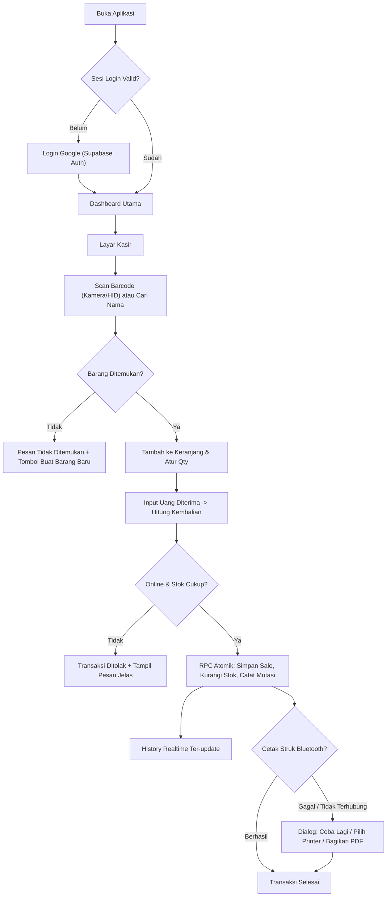

# PRD Final: src dimas kasir v0.1.0

**Status:** Final (Siap Implementasi — seluruh keputusan wawancara telah dikunci).

---

## 1. Masalah, Tujuan, dan Ukuran Sukses

- **Jenis produk:** Aplikasi mobile kasir (*Point of Sale*) Android berbasis React Native + Expo.
- **Konteks:** Dibangun untuk toko pribadi pemilik (warung/toko kelontong dan retail kecil dengan barang fisik berbarcode, stok terbatas, pembayaran tunai), namun tetap terbuka untuk akun Google lain dengan isolasi data penuh.
- **Masalah utama:** Menggantikan pencatatan manual (buku & kalkulator) yang membuat perhitungan total/kembalian lambat atau salah, stok fisik tidak terpantau, dan laba harian tidak diketahui.
- **Ukuran sukses (KPI):**
  - Satu transaksi kasir (3 item) selesai dalam `< 20 detik`.
  - Stok di sistem 100% sinkron dengan mutasi fisik (penjualan, void, stok masuk, penyesuaian).
  - Laba kotor dan laba bersih harian langsung terlihat tanpa perhitungan manual.
- **Anggaran & Tenggat:** Anggaran `Rp0` (memanfaatkan Supabase & Expo free tier), tenggat fleksibel (proyek pribadi).

---

## 2. Pengguna dan Model Akses

| Aspek | Keputusan |
| :--- | :--- |
| Model akun | 1 akun Google = 1 toko. Pemilik merangkap kasir. |
| Role | 1 role (pemilik). Tidak ada akun kasir terpisah. |
| Akses login | Semua akun Google boleh masuk; akun baru otomatis mendapat 1 toko sendiri. |
| Isolasi data | Wajib terisolasi ketat per akun melalui Supabase Row Level Security (RLS). |
| Autentikasi | Google Auth via Supabase Auth. |

---

## 3. Spesifikasi Fitur v0.1.0

### 3.1 Login, Register & Onboarding
- Satu tombol **"Masuk dengan Google"**. Akun baru otomatis dibuat beserta record toko default (`"Toko Saya"`) dan 6 kategori pengeluaran bawaan.
- **Tanpa layar onboarding wajib:** Setelah login, pengguna langsung masuk ke Dashboard Utama. Data toko (nama, alamat, no HP, logo) dapat diubah kapan saja melalui menu Profil.
- Printer Bluetooth yang belum dipilih **tidak menghalangi** pengguna melakukan transaksi.

### 3.2 Dashboard Utama
Menampilkan ringkasan operasional hari ini (berdasarkan zona waktu perangkat pengguna):
- Total penjualan hari ini (format `Rp15.000`).
- Jumlah transaksi selesai hari ini (tidak menghitung transaksi `void`).
- Laba kotor & laba bersih hari ini.
- Daftar barang dengan stok menipis (`stok <= stok_minimum`).
- 5 transaksi terakhir.
- Tombol aksi cepat menuju layar **Kasir**.

### 3.3 Data Barang (CRUD)
- **Field:** `nama` (wajib), `barcode` (opsional, unik per toko jika diisi), `kategori` (opsional), `harga_jual` (wajib, bulat `>= 0`), `harga_modal` (opsional, default `0`, bulat `>= 0`), `stok` (default `0`, bulat `>= 0`), `stok_minimum` (default `0`, bulat `>= 0`).
- **Aksi:** Tambah, Lihat/Cari, Ubah, Hapus.
- **Input Barcode:** Bisa diisi lewat scan kamera HP, scanner eksternal HID, atau ketik manual. Barang tanpa barcode tetap bisa dicari berdasarkan nama.
- **Aturan Hapus Barang:**
  - Pernah terjual (punya relasi di `sale_items`): **nonaktifkan (*soft delete*)** agar hilang dari kasir dan daftar aktif, tetapi history dan laporan lama tetap utuh.
  - Belum pernah terjual: boleh **hapus permanen**.

### 3.4 Kasir: Keranjang, Total & Kembalian
- Tambah item ke keranjang lewat scan barcode (kamera HP atau scanner eksternal) atau pencarian nama barang.
- Ubah kuantitas (`+`/`-`/ketik) dan hapus item dari keranjang.
- **Pembayaran:** **Tunai saja** di v0.1.0 (tanpa pilihan/label metode non-tunai, tanpa diskon, tanpa pajak/PPN).
- Pengguna menginput nominal uang diterima (dilengkapi tombol nominal cepat seperti uang pas, `Rp50.000`, `Rp100.000`); sistem menghitung kembalian (`uang_diterima - total`) secara otomatis.
- Transaksi ditolak jika `uang_diterima < total` atau jika stok salah satu item tidak mencukupi.
- Hasil akhir: transaksi tersimpan atomik, stok berkurang otomatis, mutasi stok tercatat, nomor struk terbit, dan opsi cetak/bagikan struk muncul.

### 3.5 Scan Barcode (Kamera HP & Scanner Eksternal)
- **Sumber scan (keduanya wajib):**
  1. **Kamera HP** menggunakan `expo-camera`.
  2. **Scanner eksternal mode HID** (Bluetooth atau USB OTG yang mengirim teks barcode + tombol `Enter`). Layar kasir menyediakan input tersembunyi/fokus khusus yang menangkap input HID tanpa mengganggu interaksi layar.
- **Lokasi penggunaan:**
  1. Layar **Kasir** (langsung menambah item ke keranjang atau menambah qty +1 jika sudah ada).
  2. Form **Tambah/Edit Barang** (mengisi kolom kode barcode).
- **Jika barcode tidak ditemukan di Kasir:** Tampilkan pesan *"Barang tidak ditemukan"* beserta tombol **"Buat barang baru"** yang langsung membuka form tambah barang dengan kolom barcode sudah terisi.

### 3.6 Kelola Stok & Riwayat Mutasi
- **Jenis mutasi manual:**
  - **Stok Masuk:** Menambah stok barang, disertai kolom catatan opsional.
  - **Penyesuaian:** Koreksi hasil hitung fisik (bisa tambah atau kurang, hasil akhir tidak boleh `< 0`), **alasan wajib diisi**.
- **Riwayat stok (`stock_movements`):** Mencatat seluruh perubahan stok dari 4 sumber: `stok_masuk`, `penyesuaian` (termasuk import CSV yang mengubah stok), `penjualan`, dan `void`. Setiap baris mencatat barang, delta jumlah, stok sesudah, jenis, catatan/alasan, dan waktu.
- **Stok tidak boleh minus:** Penjualan gagal secara atomik jika stok tidak cukup.
- **Ambang stok menipis:** Barang masuk daftar peringatan saat `stok <= stok_minimum`.

### 3.7 Struk & Cetak
- **Format nomor struk:** `SDK-YYYYMMDD-XXXX` (reset ke `0001` setiap hari per toko berdasarkan zona waktu perangkat, contoh: `SDK-20261123-0001`).
- **Format mata uang:** `Rp15.000` (tanpa spasi setelah `Rp`, pemisah titik ribuan, tanpa desimal `,00`).
- **Metode cetak & bagikan:**
  1. **Printer thermal Bluetooth ESC/POS generik** ukuran **58mm** atau **80mm** (kompatibel Eppos, Panda, VSC, RPP02, dsb.) melalui native module `react-native-thermal-receipt-printer-image-qr` (wajib **Expo Development Build**, bukan Expo Go).
  2. **Bagikan PDF/gambar** lewat share sheet Android (`expo-print` + `expo-sharing`, misalnya kirim ke WhatsApp).
- **Isi struk:** Logo toko (opsional), nama toko, alamat, no HP, nomor struk, tanggal & jam, daftar item (nama, qty × harga, subtotal), total, uang diterima, kembalian, dan teks footer.
- **Alur gagal cetak (printer mati/terputus):**
  - Transaksi **tetap tersimpan** (kegagalan cetak tidak pernah membatalkan transaksi).
  - Tampilkan dialog gagal cetak dengan 3 tombol: **Coba lagi**, **Pilih printer lain**, dan **Bagikan sebagai PDF**.
  - Struk selalu bisa dicetak ulang dari menu History.

### 3.8 Pencatatan Keuangan
- **Pemasukan:** Otomatis dari transaksi penjualan berstatus `selesai`.
- **Pengeluaran:** Input manual dengan field: `kategori`, `nominal` (bulat `> 0`), `catatan` (opsional), `tanggal`.
- **Kategori pengeluaran:** 6 kategori bawaan otomatis saat toko dibuat (**Belanja Stok**, **Listrik & Air**, **Operasional/Kemasan**, **Gaji/Upah**, **Sewa**, **Lainnya**), ditambah fitur tambah/hapus kategori kustom oleh pemilik.
- **Perhitungan laba:**
  - Harga modal yang dipakai adalah **harga modal saat transaksi** (disimpan sebagai snapshot pada `sale_items`). Mengubah harga modal barang di kemudian hari tidak mengubah laporan transaksi lama.
  - Rumus:
    $$\text{Laba Kotor} = \sum (\text{harga\_jual\_saat\_transaksi} - \text{harga\_modal\_saat\_transaksi}) \times \text{qty}$$
    $$\text{Laba Bersih} = \text{Laba Kotor} - \text{Total Pengeluaran Periode}$$

### 3.9 Laporan Usaha
- **Filter periode:** Hari ini, 7 hari terakhir, Bulan ini, dan Rentang custom. Batas "hari ini" mengikuti zona waktu perangkat (otomatis WIB/WITA/WIT).
- **Isi laporan:** Total penjualan, jumlah transaksi, laba kotor, laba bersih, total pengeluaran, **Top 5 barang terlaris** (berdasarkan total unit terjual), dan daftar stok menipis.
- **Visualisasi:** Kartu ringkasan angka dan grafik tren di dalam aplikasi.
- **Ekspor:** Unduh/bagikan laporan periode terpilih ke format **CSV**. (Ekspor PDF laporan di luar cakupan v0.1.0.)

### 3.10 Import & Export CSV Barang
- **Template tetap:** `nama,barcode,kategori,harga_jual,harga_modal,stok,stok_minimum`
- **Validasi baris:**
  - Kolom wajib: `nama`, `harga_jual`. Kolom lain opsional (kosong dianggap `0` untuk angka atau kosong untuk teks).
  - Harga dan stok wajib bilangan bulat `>= 0`.
  - Barcode duplikat di dalam file CSV: baris kedua dan seterusnya ditandai error.
  - Batas maksimal **1.000 baris** per file.
- **Alur import:**
  1. Pilih file CSV dari perangkat.
  2. Tampilkan layar **Preview** berisi ringkasan jumlah baris valid vs error, beserta alasan detail tiap baris error.
  3. Konfirmasi import: baris valid tetap diproses walau ada baris error.
  4. Barcode yang sudah ada di toko di-**update (*upsert*)**; barcode baru atau kosong ditambahkan sebagai barang baru.
  5. Jika import mengubah nilai stok barang yang sudah ada (atau menetapkan stok awal > 0), selisihnya otomatis dicatat di `stock_movements` sebagai jenis **`penyesuaian`** dengan catatan `"Import CSV"`.
- **Export:** Mengekspor seluruh barang aktif ke 1 file CSV dan dibagikan/disimpan lewat share sheet Android.

### 3.11 Menu Profil
- Edit profil toko: nama toko, alamat, no HP, logo toko (upload ke Supabase Storage).
- Pengaturan struk: teks footer struk, pilihan ukuran kertas (`58mm` / `80mm`).
- Pengaturan printer: scan, pilih, simpan, dan tes cetak ke printer thermal Bluetooth.
- Kelola kategori pengeluaran kustom.
- **Logout.**
- **Hapus Akun Permanen:** Menghapus permanen seluruh data toko (`stores`, `products`, `stock_movements`, `sales`, `sale_items`, `expenses`, `expense_categories`, file logo) dan akun auth. Wajib konfirmasi 2 langkah: pengguna mengetik ulang nama toko persis lalu menekan tombol Hapus. Tidak dapat dipulihkan.

### 3.12 History Transaksi Realtime & Void
- Menampilkan daftar transaksi terbaru lengkap dengan jam transaksi, nomor struk (`SDK-YYYYMMDD-XXXX`), total, ringkasan item, dan status (`selesai` / `void`).
- **Realtime:** Ter-update otomatis melalui **Supabase Realtime** tanpa refresh manual.
- **Detail & Cetak Ulang:** Ketuk transaksi untuk melihat rincian struk dan tombol **Cetak Ulang** atau **Bagikan PDF**.
- **Aturan Void (Pembatalan):**
  - **Alasan wajib diisi** (teks singkat) dan tersimpan di history.
  - **Tanpa batas waktu.**
  - Hanya bisa dilakukan **1 kali** per transaksi dan **tidak bisa dibatalkan lagi** (no undo).
  - Transaksi tidak dihapus; status berubah menjadi `void`, stok seluruh item dikembalikan secara atomik, dan tercatat di `stock_movements` dengan jenis `void`.

---

## 4. Alur Utama Transaksi Kasir



---

## 5. Arsitektur Data & Aturan Bisnis

### 5.1 Entitas Utama (Supabase PostgreSQL)

| Tabel | Kolom Utama |
| :--- | :--- |
| `stores` | `id`, `owner_id` (unique FK `auth.users`), `name`, `address`, `phone`, `logo_url`, `receipt_footer`, `paper_size` (`58`/`80`), `created_at` |
| `products` | `id`, `store_id`, `name`, `barcode` (unique partial index per store saat tidak null), `category`, `sell_price` (int), `cost_price` (int), `stock` (int `>= 0`), `min_stock` (int `>= 0`), `is_active` (bool), `created_at`, `updated_at` |
| `stock_movements` | `id`, `store_id`, `product_id`, `type` (`stok_masuk`, `penyesuaian`, `penjualan`, `void`), `qty_delta` (int), `stock_after` (int), `note`, `reference_id`, `created_at` |
| `sales` | `id`, `store_id`, `receipt_number` (unique per store), `total_amount` (int), `cash_received` (int), `change_amount` (int), `status` (`completed`, `void`), `void_reason`, `voided_at`, `created_at` |
| `sale_items` | `id`, `sale_id`, `product_id`, `product_name_snapshot`, `qty` (int), `sell_price_snapshot` (int), `cost_price_snapshot` (int), `subtotal` (int) |
| `expense_categories` | `id`, `store_id`, `name`, `is_default` (bool), `created_at` |
| `expenses` | `id`, `store_id`, `category_id`, `category_name_snapshot`, `amount` (int), `note`, `expense_date` (date), `created_at` |

### 5.2 Aturan Bisnis Wajib
1. **Atomisitas Transaksi & Void:** Operasi simpan transaksi + kurangi stok + catat mutasi stok (dan void + kembalikan stok) wajib dijalankan di dalam **PostgreSQL RPC / transaction** (`FOR UPDATE` row lock pada `products`) agar tidak pernah terjadi race condition atau stok minus.
2. **Online-First:** Jika perangkat tidak memiliki koneksi internet, tombol proses transaksi menahan permintaan dan menampilkan pesan koneksi terputus (tidak menyimpan antrean offline).
3. **Isolasi RLS:** Seluruh tabel wajib mengaktifkan Row Level Security dengan policy `store_id IN (SELECT id FROM stores WHERE owner_id = auth.uid())`.
4. **Integritas Historis:** `sale_items` menyimpan snapshot nama, harga jual, dan harga modal saat transaksi terjadi.

---

## 6. Tech Stack & Batasan Teknis

| Komponen | Teknologi |
| :--- | :--- |
| Framework & Bahasa | React Native + Expo (SDK terbaru) + TypeScript |
| Navigasi | Expo Router (file-based routing) |
| Styling | NativeWind (Tailwind CSS) |
| State & Data Fetching | Zustand (keranjang, printer, UI state) + TanStack Query (server cache) |
| Form & Validasi | React Hook Form + Zod |
| Animasi & Ikon | `react-native-reanimated`, Lucide / Font Awesome |
| Backend & DB | Supabase (PostgreSQL, Auth Google, Realtime, Storage) |
| Scan Kamera | `expo-camera` (Barcode scanning) |
| Scan Eksternal | Input HID Keyboard listener (Bluetooth / USB OTG) |
| Cetak & PDF | `react-native-thermal-receipt-printer-image-qr` (ESC/POS 58/80mm) + `expo-print` + `expo-sharing` |
| CSV Engine | `papaparse` + `expo-document-picker` + `expo-file-system` |
| Target Platform | Android 8.0+ (API 26+) via **Expo Development Build** (EAS Build / local `expo prebuild`) |

---

## 7. Di Luar Cakupan (Out of Scope v0.1.0)

- Platform iOS.
- Mode offline / sinkronisasi lokal SQLite.
- Multi-toko dan multi-role (kasir/karyawan terpisah).
- Diskon (per item/transaksi) dan pajak/PPN.
- Metode pembayaran non-tunai (QRIS, transfer, e-wallet) dan payment gateway.
- Kasbon / utang pelanggan dan manajemen pelanggan/member.
- Varian produk (warna/ukuran/satuan bertingkat).
- Manajemen supplier dan purchase order (PO).
- Ekspor laporan ke PDF (hanya struk yang mendukung PDF; laporan diekspor ke CSV).
- Publikasi ke Google Play Store.

---

## 8. Risiko Teknis & Mitigasi

| Risiko | Mitigasi |
| :--- | :--- |
| **Expo Go tidak mendukung Bluetooth native** | Gunakan Expo Development Build (`npx expo prebuild` / EAS development profile) sejak awal Fase 1. |
| **Perbedaan karakter ESC/POS antar printer thermal** | Gunakan perintah standar ESC/POS 32 karakter/baris (58mm) dan 48 karakter/baris (80mm) serta sediakan tombol "Tes Cetak" di Profil. |
| **Scanner HID memicu soft keyboard Android muncul terus** | Gunakan `showSoftInputOnFocus={false}` pada input tersembunyi penerima HID di layar kasir. |
| **Google Auth OAuth di Android Dev Build** | Daftarkan SHA-1 keystore debug & release pada Google Cloud Console + konfigurasi deep link scheme Expo. |

---

## 9. Kriteria Penerimaan (Acceptance Criteria)

```gherkin
Scenario: Transaksi tunai sukses dengan scan barcode
  Given pengguna login dan barang "Indomie Goreng" (harga Rp3.500, modal Rp2.800, stok 10) aktif
  When pengguna scan barcode barang tersebut 2 kali di Kasir
  And mengisi uang diterima Rp10.000 lalu menyelesaikan transaksi
  Then sistem menghitung total Rp7.000 dan kembalian Rp3.000
  And transaksi tersimpan dengan nomor struk "SDK-YYYYMMDD-0001"
  And stok barang menjadi 8 dan tercatat di riwayat stok sebagai "penjualan" (-2)
  And transaksi langsung muncul di History tanpa refresh manual

Scenario: Transaksi ditolak jika stok kurang
  Given barang "Air Mineral" memiliki stok 1
  When pengguna memasukkan qty 2 ke keranjang dan mencoba bayar
  Then sistem menolak transaksi dengan pesan stok tidak cukup
  And stok tetap 1

Scenario: Barcode tidak ditemukan di Kasir
  Given barcode "899999999" belum terdaftar
  When pengguna scan barcode "899999999" di Kasir
  Then tampil pesan "Barang tidak ditemukan" dengan tombol "Buat barang baru"
  And menekan tombol tersebut membuka form Tambah Barang dengan kolom barcode terisi "899999999"

Scenario: Gagal cetak tidak membatalkan transaksi
  Given transaksi berhasil tersimpan dan printer Bluetooth tidak terhubung
  When aplikasi mencoba mencetak struk
  Then transaksi tetap berstatus "selesai" di database
  And tampil dialog dengan 3 tombol: "Coba lagi", "Pilih printer lain", dan "Bagikan sebagai PDF"

Scenario: Void transaksi wajib alasan dan mengembalikan stok
  Given transaksi "SDK-20261123-0001" berstatus "selesai" berisi 2 unit "Indomie Goreng"
  When pengguna memilih Void tanpa mengisi alasan
  Then sistem menolak dan meminta alasan wajib diisi
  When pengguna mengisi alasan "Salah input barang" dan mengonfirmasi Void
  Then status transaksi menjadi "void", alasan tersimpan, stok bertambah 2 di riwayat stok
  And transaksi tidak dapat di-void untuk kedua kalinya

Scenario: Import CSV parsial dengan baris error
  Given file CSV berisi 10 baris dengan 2 baris memiliki harga negatif
  When pengguna memilih file tersebut di menu Import CSV
  Then layar Preview menampilkan 8 baris valid dan 2 baris error beserta alasannya
  When pengguna menekan Impor
  Then 8 baris valid masuk (barcode ada di-update, baru ditambahkan)
  And perubahan stok dari baris update tercatat di riwayat stok sebagai "penyesuaian"

Scenario: Laba akurat menggunakan modal saat transaksi
  Given barang terjual 1 unit saat harga jual Rp5.000 dan harga modal Rp3.000
  When pemilik mengubah harga modal barang menjadi Rp4.000 keesokan harinya
  Then laporan periode transaksi lama tetap menghitung laba kotor sebesar Rp2.000

Scenario: Hapus barang pernah terjual (Soft Delete)
  Given barang "Kopi Sachet" sudah pernah tercatat pada 1 transaksi
  When pengguna menghapus barang tersebut
  Then barang dinonaktifkan dan tidak muncul lagi di Kasir maupun daftar barang aktif
  And history transaksi lama tetap menampilkan "Kopi Sachet" dengan utuh

Scenario: Hapus akun permanen 2 langkah
  Given nama toko pengguna adalah "Warung Dimas"
  When pengguna memilih Hapus Akun, mengetik "Warung Dimas", dan mengonfirmasi
  Then seluruh data toko dan akun pengguna terhapus permanen dan pengguna keluar ke layar Login
```
